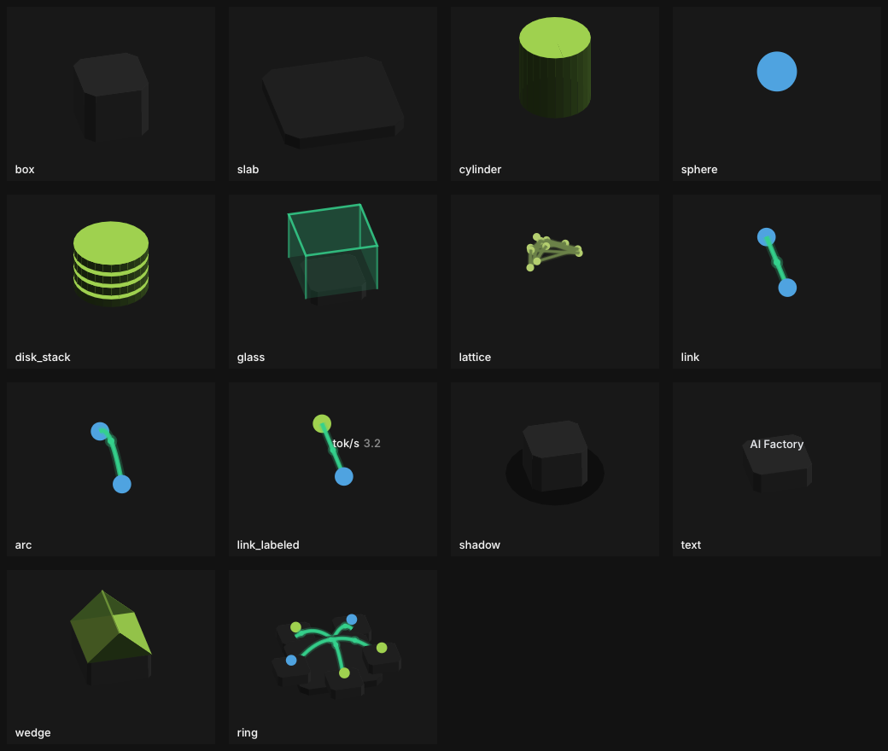
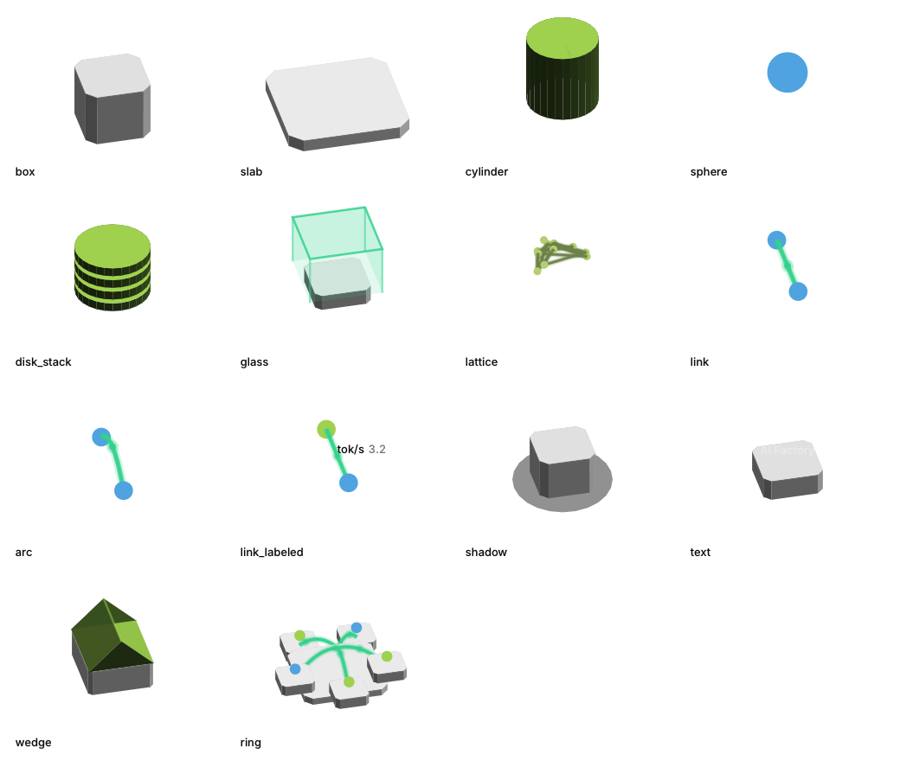

# cui-iso — an isometric diorama layer for CUI

`cui-iso` draws little 3D-looking scenes (a platform, some boxes, a glass
case) on top of CUI's ordinary 2D draw calls. No WebGL, no mesh files, no
textures, no second renderer. A diorama is just a paint function, the same
kind you already write for buttons and panels, so it runs on every CUI
backend — software, OpenGL, WebAssembly — and sits next to regular widgets
in the same frame.

It is the first CUI extension to give you depth. CUI itself has no depth
buffer and no 3D API; the closest you could get was stacking flat polygons
by hand.

## Why it exists

CUI gives you `cui_draw_polygon`, `cui_draw_polyline`, `cui_draw_circle`
and `cui_draw_line`. That is it. To make a box look like a box you have to:

- project world points (x right, y forward, z up) into screen space,
- work out which faces are visible and in what order,
- shade each side against a light so it reads as a solid and not a flat
  rhombus,
- sort whole objects back to front so the front one overlaps the back one,
- cut the vertical corners of your boxes (chamfer) or the silhouette
  collapses into a hexagon.

That is roughly 300 lines of easy-to-get-wrong code, and every project
that wants a scene rewrites it. `cui-iso` is that code, extracted once and
done properly. It is the proven version pulled out of the `mcpd-ui` control
surface (`../mcpd-ui/mcpd_ui.c`), which hand-rolls exactly this to draw a
hub platform, service pods, glass vitrines and contact shadows. Nothing in
`cui-iso` depends on `mcpd-ui`; the dependency runs the other way.

## The API at a glance

Everything lives in `cui_iso.h`. Two structs do the setup:

- `cui_iso_camera` — `az` (orbit angle in radians), `cx`/`cy` (the screen
  point that world origin maps to), `scale` (pixels per world unit).
- `cui_iso_light` — one fixed world light plus a floor..ceil brightness
  range for the sides. `cui_iso_light_default()` matches the mcpd-ui look.

The camera helpers are usable on their own:

- `cui_iso_project(cam, x, y, z)` → a `cui_vec2` in CUI screen space.
- `cui_iso_depth(cam, x, y)` → a painter's-algorithm depth (larger =
  closer). Sort by this, ascending, and draw in that order.

For a whole scene you skip the sorting and let the scene do it. Fill a
batch between `cui_iso_begin` and `cui_iso_end`; nothing is drawn until
`cui_iso_end`, which is what gives you correct overlap:

- `cui_iso_grid` — a tiled ground plane, drawn first (the floor most
  dioramas sit on).
- `cui_iso_shadow` — a flat ground ellipse, drawn first (contact shadow or
  ambient glow).
- `cui_iso_slab` — a thin platform.
- `cui_iso_box` — a chamfered box, top face flat-coloured, sides shaded by
  the light.
- `cui_iso_cylinder` — a vertical cylinder (tanks, pillars, pipes), shaded
  strip-by-strip so it matches the boxes.
- `cui_iso_sphere` — a depth-sorted ball (molecule atoms, node markers,
  particles) with a top-left highlight.
- `cui_iso_disk_stack` — a stack of flat disks (the database-drum motif).
- `cui_iso_wedge` — a triangular prism: a pitched roof or a ramp.
- `cui_iso_link` — a connection between two world points (conduits, pipes,
  edges), drawn as a glow + body + core, with an optional travelling pulse
  dot you animate by moving one 0..1 value.
- `cui_iso_arc` — a curved conduit that bulges above the straight path (the
  ring conduits and curved flow arrows).
- `cui_iso_lattice` — a ball-and-stick graph in one call: the recurring
  neural-net motif, without hand-placing twenty spheres and links.
- `cui_iso_glass` — a translucent vitrine with a neon frame, drawn on top
  of the opaque solids.
- `cui_iso_text` — a caption anchored at a world point, depth-sorted like a
  solid.
- `cui_iso_end` — sorts and draws the batch into a `cui_ctx *`.

Opaque solids — boxes, cylinders, wedges, spheres, links, arcs — share one
depth-sorted pass, so a sphere sits correctly in front of and behind the
boxes around it. Glass is always drawn after them.

Two layout helpers save you the trig:

- `cui_iso_ring` — places `count` solids evenly around a circle (the
  hub-and-spoke layout), optionally drawing a pulsing spoke arc from the
  centre to each one.

For clicking: `cui_iso_hit_box`, `cui_iso_hit_sphere` and
`cui_iso_hit_cylinder` each test one solid, and `cui_iso_pick` returns the
index of the front-most solid under a screen point, so a click selects
whatever the user actually pointed at.

### Motion and accessibility

Following CUI's design bar, every animation has a reduced-motion path. Call
`cui_iso_set_reduced_motion(scene, true)` (wire it to CUI's own
reduced-motion setting) and travelling pulses freeze at rest instead of
animating, so a motion-sensitive user still gets a complete scene.

### Labels and live values

The pipeline-style scenes in NVIDIA's blog art — `LLM → Optimize →
Deploy`, with a number on each arrow that updates while flow animates —
need text on the scene. `cui_iso_link_labeled` is a link that carries a
label and a live number floating at its midpoint:

```c
/* a link that reads "LLM --tok/s 3.2--> Optimize", pulse travelling */
cui_iso_link_labeled(&scene, llm.x, llm.y, 40, opt.x, opt.y, 40,
                     2.0f, CUI_RGB(0x34d18c), pulse, "tok/s", 3.2f, 1);
```

Move `pulse` (and the value) each frame and the dot travels the link while
the number updates. All labels share one `cui_iso_text_style`, set once
with `cui_iso_set_text_style`, so a whole scene's text stays consistent.

### Slots: no magic numbers

Placing solids by hand means typing coordinates — and working out where the
edge of a box is, or how high its top is. Slots hand that job to the library.
You ask for a layout, place solids at the slots it gives you, and stack with
`cui_iso_on` instead of adding heights by hand:

```c
cui_iso_slot station[3];
cui_iso_layout_row_ex(station, 3,
    &(cui_iso_layout_row_opts){ .spacing = 110 });   // three places, 110 apart

cui_iso_slab_named(scene,
    .cx = station[0].x, .cy = station[0].y, .z_top = 0,
    .w = 70, .d = 58, .height = 14, .top = top, .side = side);
cui_iso_sphere_named(scene,
    .x = station[0].x, .y = station[0].y, .z = 14, .radius = 8, .color = accent);

/* connect two slots; the link is trimmed to their edges automatically */
cui_iso_link_between(scene, cui_iso_on(station[0], 14),
                     cui_iso_on(station[1], 14), 20.0f, 2.0f, color, pulse);
```

The library also hands out rings (`cui_iso_layout_ring_ex`) and grids
(`cui_iso_layout_grid_ex`). Solids take named fields (`_named`, or `_ex` with an
options struct); include `<cui/cui_iso_opts.h>` for those. A scene written this way has no coordinate numbers
in it at all — you tune the numbers that are real choices (how big, how far
apart, how high) and never work out a position. Rewriting one of the bundled
cases this way took it from nine hand-computed coordinates to three, and the
three that remain are gap sizes, not positions.

## A diorama in a few lines

```c
static cui_iso_scene *scene;

void draw_diorama(cui_ctx *ui)
{
    if (!scene) scene = cui_iso_scene_create();
    cui_iso_camera cam = { .az = 0.6f, .cx = 380, .cy = 300, .scale = 1.0f };

    cui_iso_begin(scene, &cam);
    cui_iso_shadow_named(scene, .rx = 150, .ry = 150,
                         .color = CUI_RGBA(0x00000040));
    cui_iso_slab_named(scene, .w = 220, .d = 220, .height = 12,
                       .top = CUI_RGB(0x2a2f38), .side = CUI_RGB(0x1b1f26));
    cui_iso_box_named(scene, .cx = -50, .cy = -30, .z_top = 12,
                      .w = 60, .d = 60, .height = 48, .chamfer = 8,
                      .top = CUI_RGB(0x4a5568), .side = CUI_RGB(0x3a4350));
    cui_iso_box_named(scene, .cx = 55, .cy = 40, .z_top = 12,
                      .w = 50, .d = 70, .height = 30, .chamfer = 6,
                      .top = CUI_RGB(0x5b6b4a), .side = CUI_RGB(0x46523a));
    cui_iso_glass_named(scene, .cx = -50, .cy = -30, .z_bottom = 12,
                        .w = 60, .d = 60, .height = 56,
                        .tint = CUI_RGBA(0xafca4c30));
    cui_iso_end(scene, ui);
}
```

Before `cui-iso`, that meant hand-writing the projection, the prism
tessellation, the per-face shading, and the depth sort. Now it is six
calls and a camera. Call `cui_iso_scene_reset(scene)` (or just re-`begin`)
each frame; the scene reuses its storage, so there is nothing to free
between frames.

## What it is not

This is not a 3D renderer, and it does not try to be. There is no texture
mapping, no perspective, no mesh loading, and no hidden-surface removal
beyond painter's algorithm over whole solids. Rotating the camera past a
certain point can still pop a sorting order; overlapping glass is drawn in
a fixed order, not blended correctly. The output is a crisp vector
diorama — flat-shaded faces, clean edges — which is exactly right for
control surfaces and status scenes, and wrong for a game or a viewer.

If you need real 3D, use CUI's actual renderer layer (`cui_render.h`):
`cui_sw_*` for a software rasteriser and `cui_gl_*` for OpenGL, both of
which take meshes and textures through `cui_draw_data`. That is a
different job with a different trade-off. `cui-iso` is for when you want a
scene that looks designed, not simulated, and you want it in the same
immediate-mode frame as the rest of your UI.

## More

`docs/isometric-dioramas.md` is the long form: the palette, and what it took
to get light theme right; slots; picking; and every test in the suite.
`CHANGELOG.md` lists what changed and why.




## Building

`cui-iso` is a CMake target, `cui_iso`, a static library that publicly
links `cui::cui`. Add the directory and link it:

```cmake
add_subdirectory(cui-iso)
target_link_libraries(my_app PRIVATE cui_iso)
```

Two executables come with it, useful as references:

- `cui_iso_render` — renders a scene headlessly with the software renderer
  and writes it to `out.png`. This is how the library's output is diffed
  against the hand-rolled original.
- `cui_iso_demo` — opens a window with the mcpd-style hub-and-pods scene
  rebuilt on top of `cui-iso`.

Configure and build the usual way:

```sh
cmake -S . -B build
cmake --build build
./build/cui_iso_render && open out.png
```

Or install it and include it from your own project:

```sh
cmake --install build --prefix /usr/local
```

That puts `libcui_iso.a` in `lib/` and the public headers in `include/cui/`.
Include `<cui/cui_iso.h>` for the scene, camera and helpers, and
`<cui/cui_iso_opts.h>` for the named-field solids. If CUI is not beside this
directory, configure with `-DCUI_ISO_CUI_DIR=/path/to/CUI`.
