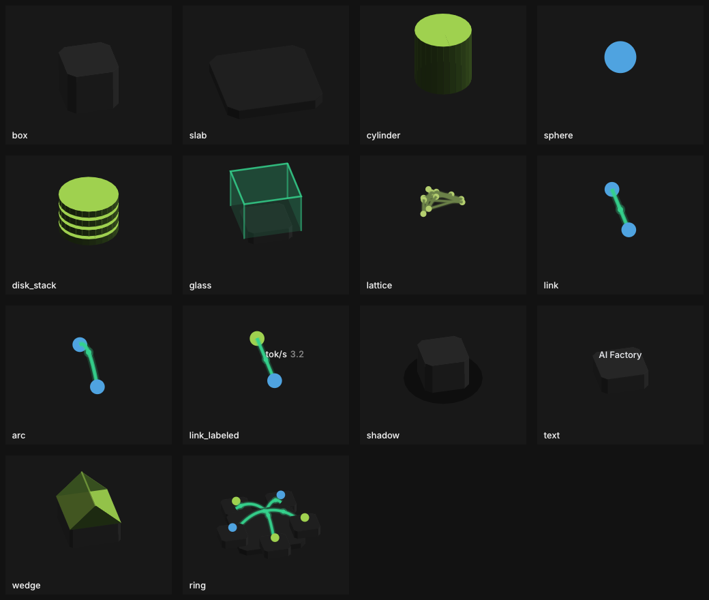
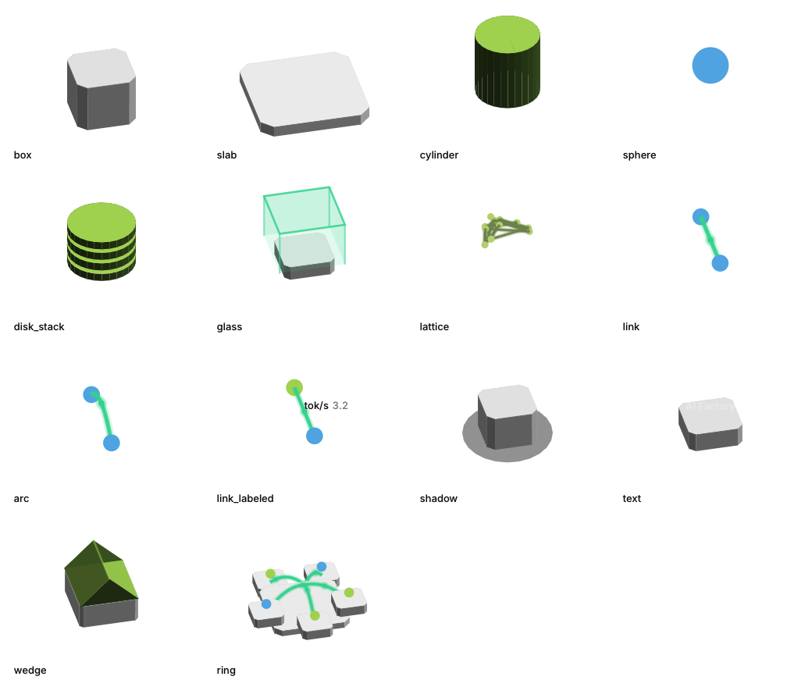

# Isometric dioramas

CUI draws flat 2D primitives: `cui_draw_polygon`, `cui_draw_polyline`,
`cui_draw_circle`, `cui_draw_line`, `cui_draw_text`. There is no depth buffer,
no mesh and no 3D API. A diorama is the one thing those primitives cannot do on
their own, because a box that reads as a box needs a projection, a face order,
a shading rule and a sort. That is roughly 300 lines of easy-to-get-wrong code,
and every project that wants one rewrites it.

`cui-iso` is that code, once. It goes in the same paint function as the rest of
your UI and works on every backend, because it draws with the same `cui_draw_*`
calls.

## What it costs

About 17 KiB in a `MinSizeRel` build, measured on this machine as the difference
between an app that draws a platform, a block, a sphere and a link and the same
app that does not. `examples/hello` alone is 291648 bytes, so the layer is about
6% of it. That matters because size is a rule in this project, not a preference.

## The camera

    cui_iso_camera cam = { .az = 0.55f, .cx = 300, .cy = 250, .scale = 1.0f };

`az` orbits, `cx`/`cy` place world origin on screen, `scale` is pixels per world
unit. World axes are x right, y forward, z up.

Rotating the camera re-shades every side against one fixed world light. That is
the whole look: flat faces, clean edges, one light.

## Solids

Fill a batch between `cui_iso_begin` and `cui_iso_end`. Nothing is drawn until
`end`, which is what lets it sort for you.

| Call | Draws |
| --- | --- |
| `cui_iso_box` | a chamfered box |
| `cui_iso_slab` | a thin platform |
| `cui_iso_wedge` | a pitched roof or ramp |
| `cui_iso_cylinder` | a tank, pillar, pipe |
| `cui_iso_sphere` | a ball: node, atom, particle |
| `cui_iso_glass` | a translucent vitrine over a footprint |
| `cui_iso_grid` | a tiled ground plane |
| `cui_iso_shadow` | a flat ground ellipse |
| `cui_iso_link` | a conduit between two points, with a travelling pulse |
| `cui_iso_link_labeled` | the same, with a label and a live number |
| `cui_iso_arc` | a curved conduit |
| `cui_iso_lattice` | a ball-and-stick graph in one call |
| `cui_iso_disk_stack` | a coin / database drum stack |
| `cui_iso_text` | a caption anchored at a world point |

Three passes, in this order: the ground (shadows $HOME and the grid), the opaque
solids back to front, then glass. Text and link labels come last, in their own
overlay pass, so nothing sorted in front of a caption can paint over its letters.

## Slots: no magic numbers

Placing by hand means typing coordinates and working out where an edge is. Ask
for a layout instead:

    cui_iso_slot station[3];
    cui_iso_layout_row_ex(station, 3, &(cui_iso_layout_row_opts){ .spacing = 110 });

    cui_iso_slab_named(sc, .cx = station[0].x, .cy = station[0].y, .z_top = 0,
                       .w = 70, .d = 58, .height = 14,
                       .top = pal.plate, .side = pal.plate_side);
    cui_iso_link_between(sc, cui_iso_on(station[0], 14), cui_iso_on(station[1], 14),
                         20.0f, 2.0f, pal.ok, pulse);

`cui_iso_layout_row_ex`, `_ring_ex` and `_grid_ex` hand out places; `cui_iso_on` stacks;
`cui_iso_link_between` connects two slots and trims each end to the edge.
Converting one bundled case this way took it from nine coordinates to three, and
the three left are gaps, not positions.

## Palette

Do not hardcode colours in a diorama. `cui_iso_palette_default(ui)` derives neutral
surfaces from the theme's own background and foreground, so one scene reads in
light and in dark; the status hues are fixed, because failure means failure in
either theme.

That is not a style note. An earlier version of this page used
`CUI_COLOR_SURFACE` and `CUI_COLOR_SURFACE_RAISED` for two stacked faces. Measured,
both resolve to 255,255,255 in the light theme, so the block vanished into the
plate while dark looked correct. `tests/cui_iso_palette` now asserts the
separation in both themes, and fails with four errors against that old palette.

## Theme and motion

Call `cui_iso_palette_default(ui)` once per frame, with the context you draw
through, and pass its entries to the solids. Call `cui_iso_set_bounds(scene,
canvas_rect)` when the diorama is hosted in a panel, so a large scale cannot paint
over its neighbours.

Every animation has a reduced-motion path, per the project rule: with
`cui_iso_set_reduced_motion(scene, true)` travelling pulses freeze at rest and the
scene still reads.

## Picking

`cui_iso_pick(scene, x, y)` returns the index of the front-most solid under a
point, by the same depth key the draw pass sorts on, or -1. It is safe after
`cui_iso_end`, so a click handler can ask what was just drawn there. A box answers
across its whole volume, not only its lid; a cylinder over its rims.

## What this is not

No textures, no perspective, no mesh loading, no hidden-surface removal beyond
painter's algorithm over whole solids. Rotating far enough can pop a sort order.
Overlapping glass is drawn in a fixed order rather than blended correctly. It
produces crisp vector dioramas, which suit a control surface or a status scene
and do not suit a game or a viewer. For real 3D use `cui_render.h`: `cui_sw_*`
takes meshes and textures, and so does `cui_gl_*`.

## Tests

    ctest --test-dir build --output-on-failure

- `cui_iso_smoke`: every primitive draws and changes pixels.
- `cui_iso_limits`: maximum tessellation, capacity past the cap, degenerate
  geometry, layout at n = 0 and 1.
- `cui_iso_sort`: one scene in two insertion orders must render identical pixels.
(with the sort removed it produces 12502 differing bytes, so the test is not vacuous.)
- `cui_iso_pick`: painted against hit-tested, per pixel, for a box and a cylinder.
- `cui_iso_opts`: the named-field forms must match the positional forms byte for
  byte.
- `cui_iso_palette`: stacked faces must stay separate in light and in dark.

Build with the sanitizers on with `-DCUI_ISO_SANITIZE=ON`.
